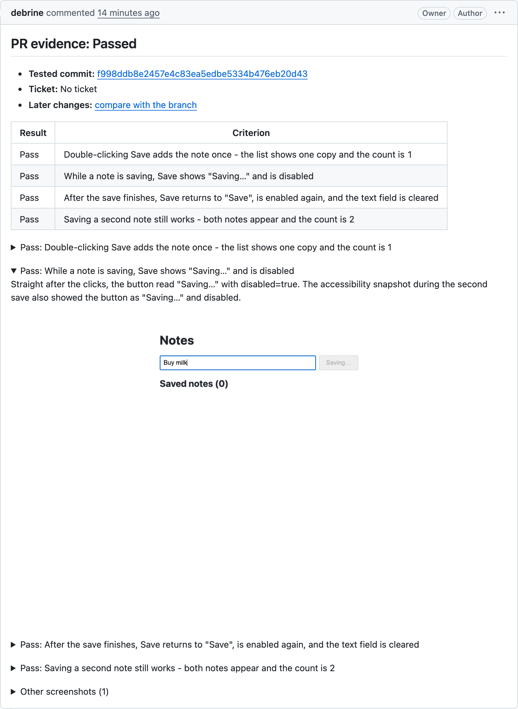

# pr-evidence

Your coding agent tests a branch in a real browser and posts the screenshots and a GIF on its pull request.

[](https://github.com/debrine/pr-evidence-demo/pull/1)

This comment was posted from a real run on [a demo pull request](https://github.com/debrine/pr-evidence-demo/pull/1) that fixes a double-clicked Save adding a note twice.

## How it works

1. You ask your agent to gather evidence for the branch.
2. It reads the diff, the PR description and the ticket, and proposes what to test. You approve or edit the list.
3. It starts your app, drives a real browser against it, and judges each criterion with a screenshot.
4. You review the evidence, and one comment on the PR is created or updated.

<!-- TRANSCRIPT: replace with 10-15 lines trimmed from the showcase run -->

If a criterion fails, the comment says "Failed", marks that row "Fail" and shows the screenshot of the failure. The tool only reports. It never changes the code under test.

## Quickstart

1. Install the helper and the skill for your agents (Claude Code, Codex and Cursor):

   ```sh
   npx pr-evidence setup
   ```

   On Windows, run `npx.cmd pr-evidence setup`. See [Windows](https://github.com/debrine/pr-evidence/blob/main/docs/windows.md).

2. Commit a `.pr-evidence.yml` saying how to start your app. Your agent offers to draft it the first time. The demo's is two lines:

   ```yaml
   start: node server.js
   readyUrl: http://localhost:3000
   ```

3. Push your branch and ask your agent:

   > Gather evidence for this branch.

## Examples

> Gather evidence for this branch.

> Gather evidence for ABC-123.

> Gather evidence for this branch with --criteria "Saving twice does not create a duplicate".

> Gather evidence for this branch with --url https://my-branch.preview.example.com

The options are listed in the [reference](https://github.com/debrine/pr-evidence/blob/main/docs/reference.md#options).

## Requirements

- Node 20 or later
- Git. On Windows, [Git for Windows](https://git-scm.com/download/win)
- The [GitHub CLI](https://cli.github.com), logged in with `gh auth login`
- A web app, with its repository on github.com or `*.ghe.com`

It runs on macOS, Linux and Windows.

## Learn more

- [Configuration](https://github.com/debrine/pr-evidence/blob/main/docs/configuration.md): the config file, apps with several processes, testing a running app, logging in
- [Windows](https://github.com/debrine/pr-evidence/blob/main/docs/windows.md): setup, Git for Windows and how processes are stopped
- [Publishing](https://github.com/debrine/pr-evidence/blob/main/docs/publishing.md): what to check first, where evidence is kept, worktrees, how the upload works
- [Reference](https://github.com/debrine/pr-evidence/blob/main/docs/reference.md): options, helper commands and prerequisites
- [Upgrading from 0.1](https://github.com/debrine/pr-evidence/blob/main/docs/upgrading.md)
- [Contributing](https://github.com/debrine/pr-evidence/blob/main/CONTRIBUTING.md)
